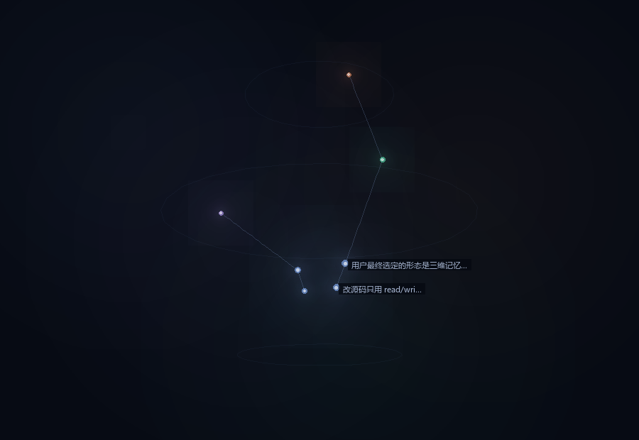

# dsh-memory-loom

Cross-session memory for **DeepSeek Harness (DSH)** — governed writes, per-turn recall, and a visual memory map.



> 中文说明见 [README.md](README.md)。The panel chrome is bilingual (zh/en); memory contents stay in whatever language you wrote them.

## What it does

| Layer | What happens |
|---|---|
| Write path | One governance chain: dedupe (with polarity/number guards) → supersede → persist → capacity eviction → archive trim |
| Four layers | `memories` (short facts) · `summaries` (compressed clusters) · `slots` (overwritable state) · `events` (audit trail) |
| Recall | Every turn's first step injects: constraints → slots → episodes → world top3 → facts top3 (with age/weak flags) → summaries |
| Forgetting | Weight decay by half-life, soft archive (`reason: capacity/superseded/summarized/bulk-log`), every entry restorable |
| Panel | A full page in the host's `main` slot plus a sidebar entry: 3D memory map, six-layer health lamps, recall trail, audit log |

## Design choices

- **Zero runtime dependencies, no network calls, no embeddings.** Tokenization is CJK bigrams + ASCII words; ranking is
  IDF-weighted query coverage (`lib/rank.js`) with a small domain alias table (`lib/aliases.js`).
  Trade-off: paraphrases are missed, but it is offline, deterministic and regression-testable.
- **No model call on the write path.** Summaries are extractive (cluster + pick complementary points); an optional
  background rewrite may use `ctx.llm` afterwards, with timeout and fallback. Writing never waits for a model.
- **Single JSON store, atomically published** (temp file → fsync → rename), all writes serialized.

## Install

```sh
git clone https://github.com/qyqy-1109/dsh-memory-loom.git
cd dsh-memory-loom
dsh plugin --profile desktop add .
# restart DSH afterwards (profile bundle + manifest changes are not part of HMR)
```

A "Memory Loom" entry appears in the left sidebar next to Plugins.

## Configure (profile `cordis.patch.yml`)

```yaml
- id: memory-loom
  name: dsh-memory-loom
  config:
    recallThreshold: 0.18
    dedupeThreshold: 0.72
    maxActiveMemories: 2000
    maxArchive: 500
    halfLifeDays: 30
    injectRecall: true
    autoCapture: true
    storePath: ''            # empty = $DSH_HOME/memory-loom/store.json
```

## Tools exposed to the model

`memory_write` (single or up to 20 entries, each with `supersedes`) · `memory_search` (semantic-ish + `since`/`until`
timeline) · `memory_forget` (soft archive / hard delete) · `memory_restore` (single entry or undo a whole summary) ·
`memory_stats`.

## Verify

```sh
node --test "test/*.test.mjs"   # 93 tests
node scripts/verify.mjs         # 25 checks against a locally installed DSH runtime
```

`verify.mjs` needs a real DSH install (it validates JSON-Schema support against `@deepseek-ai/dsh-tools`).
Point it at one with `DSH_NODE_MODULES=<DSH install>/resources/dsh/node_modules`.

## License

MIT © qyqy-1109
